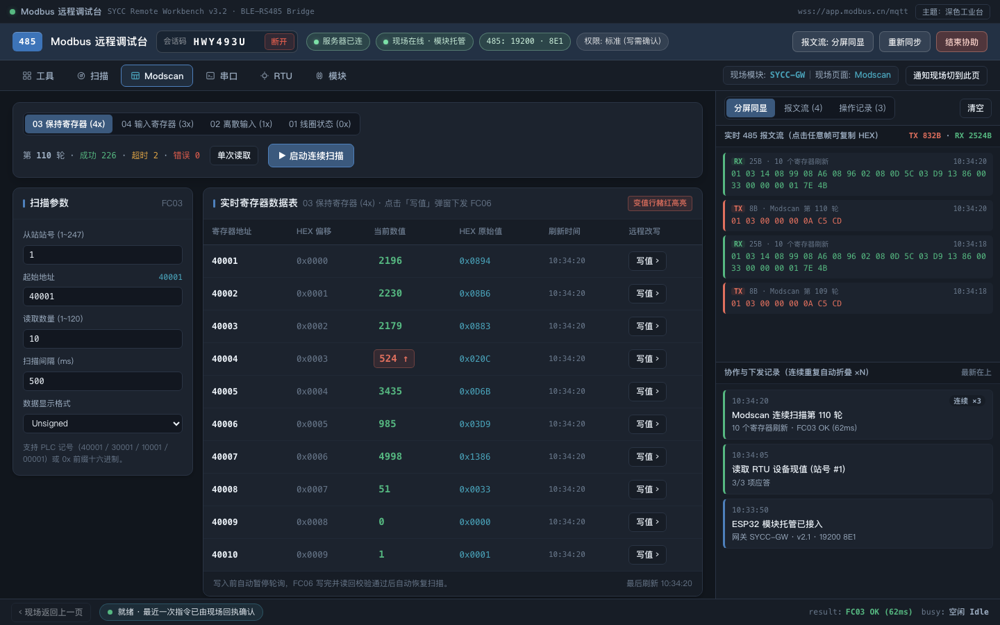
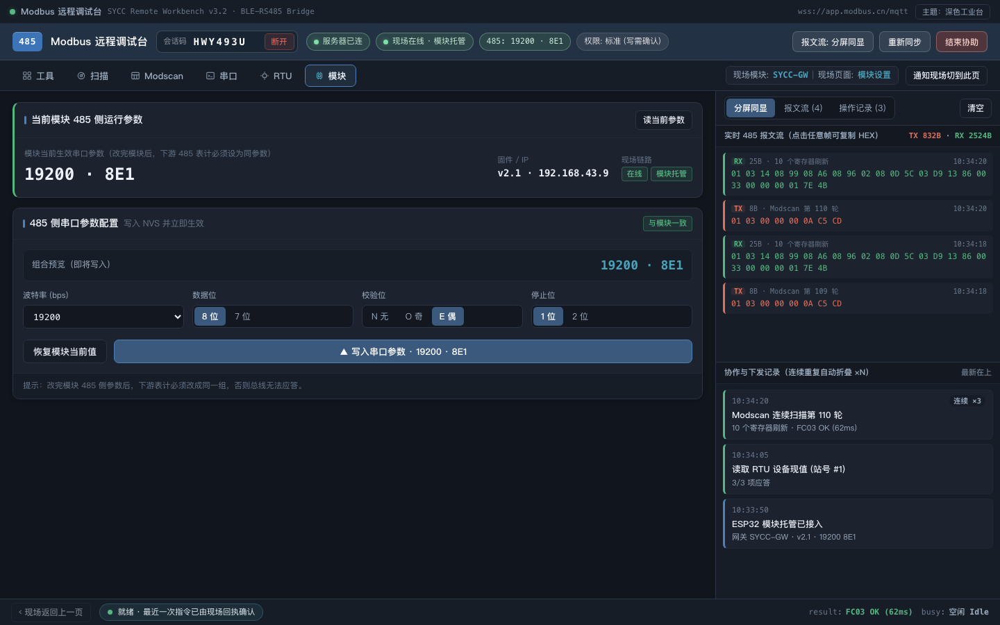
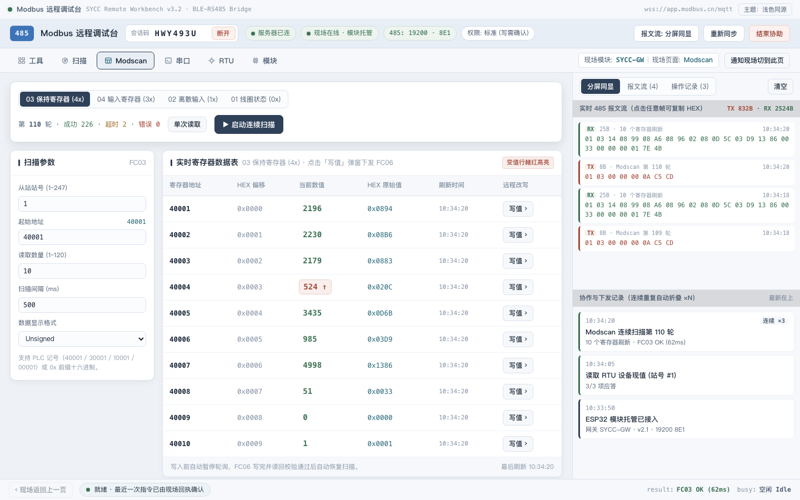

# Modbus 远程调试台（desktop-client）

小程序「远程协助」的**桌面远程端**复刻：输入现场给出的 7 位会话码，在 Windows / macOS / Linux
桌面上看到实时 485 报文流，并能远程下发命令（读寄存器、改参数、串口直发）。

现场链路有三种，**桌面端工作台是同一条**：

| 现场形态 | 谁在执行 485 | 桌面端 UI | 说明 |
| --- | --- | --- | --- |
| ESP32 WiFi 直连（Headless Gateway） | 模块自己连 broker | 网关工作台 | 现场手机可离场 |
| **BLE 小程序代理（V2.2）** | 现场手机把网关命令转成 BLE 帧 | **同一套网关工作台** | 手机只需蓝牙连着模块 |
| 手机纯镜像（旧模式） | 现场页面执行 `ui.action` | 镜像页 | 蓝牙没连/未开代理时的兜底 |

协议与小程序现场端的 `utils/assist/*`（proto / session / host）逐字节对齐。本仓库只含桌面端；
现场端协议真源在配套仓库中。

> **本仓库源码不含任何真实 broker 信息**（地址 / 端口 / 账号 / 密码全部走构建期环境变量，
> 见「Broker 配置」一节）。拿到的安装包已内置配置；自行编译时请提供你自己的 `VITE_MQTT_*`。

```
┌──────────────────┐  BLE   ┌────────────────┐  RS485  ┌─────────┐
│ 小程序现场端     │──────▶│ ESP32 BLE485   │────────▶│ RTU 设备 │
└────────┬─────────┘       └────────────────┘         └─────────┘
         │ MQTT over wss (assist/{sid}/#)
┌────────▼─────────┐
│     MQTT broker │
└────────┬─────────┘
         │ MQTT over wss                    ← 本仓库桌面端从这里接入
┌────────▼─────────┐
│  桌面远程端       │  只发意图、只收镜像，不直连硬件
└──────────────────┘
```

## ★ 网关模式：ESP32 直连 + BLE 小程序代理（两者同一套 UI）

### A. ESP32 Headless Gateway（v1.4）

新版固件（`BLE485paco.ino` v1.4）可以让 **ESP32 自己直连 broker**：现场手机在小程序里配好 WiFi、
在「WiFi 配网」页点「开启远程托管」拿到 7 位码之后就可以离场；托管无时长限制，
直到现场用 BLE 关闭 MQTT。

桌面端接入方式不变（输 7 位码 → 接入）。**V2.0 起，只要收到网关的 `status` 心跳/join
（`role:"local"` + `gw:1` 或 `tool:"SYCC-GW"`），或 `state.payload.role === "gateway"`，
就立刻切到网关调试台**，不再等现场手机的 pageSchema；同时会自动发 `sync.request` 拉全量说明书。

| 操作 | 发出的命令 | 固件行为 |
| --- | --- | --- |
| 读寄存器 | `raw.tx {hex,expectLen}` | 桌面端组完整 RTU 帧（FC01-04），固件只透传，回原始 `rx`，桌面端解析 values |
| 写寄存器 | `raw.tx {hex,expectLen}` | 桌面端组 FC05/06/0F/10；FC06/16 **写后由桌面端发 FC03 读回比对**（写类永不自动重发） |
| 扫描 1~247 | `scan.start` / `scan.stop` | 复用固件扫描状态机，进度以 `state {scan:"HIT",addr}` 推回 |
| 串口直发 | `serial.send {hex, wait:false}` | 只写总线不等应答，收包走 `data`（透传桥模式） |
| 模块 485 参数 | `uart.set {baud,dataBits,stopBits,parity}` | 写 NVS 并立即生效；面板底部「应用模块参数」 |
| 401/403 | —— | 现场托管固定「完全」权限；旧会话 / 手机托管为只读档时，写/参数命令会被固件回 403 |

> **桌面端优先（V2.0）**：桌面端 `status`/`cmd` 带 `cid` + `kind:"desktop"`。网关托管期间
> 只放行桌面端，小程序 remote 的命令回 `409`，避免两端同时抢 485 总线；桌面端断开后
> 小程序才能接管。

协议细节见配套仓库的 `BLE485paco-开发总结与接口文档.md` §12.4 与 `ESP32-WiFi配网与直连远程协助-设计需求.md`。

### B. BLE 小程序代理（V2.2）

现场没有可用 WiFi、或就想让手机当桥时：小程序用蓝牙连模块，再由手机连 MQTT。
`miniprogram/utils/assist/ble-gateway.js` 把桌面端的网关命令翻译成 BLE 帧：

| 桌面端命令 | 手机侧动作 | 模块回包 |
| --- | --- | --- |
| `raw.tx {hex,timeoutMs}` | 原样写 BLE 特征 | 收齐一帧 CRC 正确的 RTU 应答 → `{rx,rxLen,elapsed}` |
| `serial.send {hex,wait}` | 原样写 BLE | `{tx,rx,rxLen}` / `{tx,sent,bridge:true}` |
| `scan.start/stop` | 80 字节 `R-Scan485` / `R-ScanStop` | 固件 `SCAN485:*` 行 → `state {scan:"HIT"…}` |
| `uart.set` | 80 字节 `W-485Setting` | 模块回读 → `{baud,dataBits,stopBits,parity}` |

现场端在 `status` 里带 `gw:1, ble:1, link:"ble"`、在 `state` 里回
`{role:"gateway", link:"ble", uart, perm, host:1}`。桌面端**不需要任何业务分支**：
识别到网关后刷新到同一套「工具 / 扫描 / Modscan / 串口 / RTU / 模块」，
顶栏只多一个「蓝牙代理」来源标记；蓝牙一断，顶栏变「BLE 代理暂停」，命令回 `409`。

> 现场先在「远程请求接入」弹窗点「允许」；未允许前 `status` 不带 `gw`，
> `sync` 回 `{awaitAllow:true}`（顶栏显示「等待现场在小程序里点允许」），实际读写命令回 `403`。
>
> 桌面端接管后现场小程序**不再退回首页**，而是页面跟随控制端：桌面切到扫描/Modscan/串口/RTU/模块，
> 现场手机 `navigateTo/redirectTo` 到同一页；现场页的 `onMessage` 只负责本地显示，代理回包走
> `addSniffer` 旁听，两边不抢接收流。

### C. 页面双向同步（view-sync）

除了命令，桌面端与现场手机还同步**当前页 + 页面 data 快照**：

| 消息 | 方向 | 说明 |
| --- | --- | --- |
| `view.follow {page,data}` | 桌面 → 手机 | 桌面切页（工具卡片 / 导航坞 / 「通知现场切到此页」） |
| `view.patch {page,data}` | 桌面 → 手机 | 桌面表单/数据变化（节流 200ms） |
| `view {page,data,source,rev}` | 手机 → 桌面 | 现场页当前状态；桌面映射成自己的 `app.*` 后重绘 |

- 现场手机自己切页 / 读写 → 同样回 `view`，桌面端跟着切页、更新表单与表格（双向，不是单向投屏）。
- 自己发出的 patch 经 host 回显时按 `source` 丢弃，避免回环；桌面端自己的轮询不会因为镜像回传被误停。
- 只有 BLE 小程序代理有现场页；ESP32 直连网关没有小程序页面，不会发 `view.*`。

## 界面对齐：appui v3.2 桌面工作台

UI 按设计原型 `docs/appui-preview-v3.2.html` 落地（原文件 `modbus_appui_preview_v3_2.html`），与小程序同源，但按桌面习惯重新排布。

| 深色工业台 · Modscan | 深色 · 模块设置 | 浅色同源 · Modscan |
| --- | --- | --- |
|  |  |  |


- **顶部链路带**：会话码 / 服务器 / 现场在线 / 485 参数 / 权限五枚胶囊；「结束协助」「重新同步」常驻。
- **二级工具坞**：工具总览 · 扫描 · Modscan · 串口 · RTU · 模块（与小程序 6 项工具坞一一对应）。
- **双栏工作区**：左栏紧凑表单 + 参数表 + 帧预览；右栏「实时报文流 TX/RX + 协作记录」上下分屏，连续重复动作自动折叠 `×N`。
- **底部固定状态栏**：指令回执 / `result` / `busy` 常驻，不再用浮层黄条遮挡表单。
- **双主题**：深色工业台（Dark Pro）/ 浅色小程序同源（Light Sync），标题栏一键切换并记忆；
  浅色主题下顶部链路带一起切成浅色（`--hdr-*` token），不会留一条突兀的深色横杠。
- **现场离线横幅**：提醒亮屏 / 改模块托管，并提供 `ping` 唤醒与「收起提示」，不刷屏占满右栏。

| 视图 | 桌面端行为 | 依赖 |
| --- | --- | --- |
| 工具总览 | 链路卡（网关 / 固件 / IP / 485 参数 / 权限 / 报文量）+ 6 张入口卡；纯镜像时附现场镜像页 | 任意模式 |
| 扫描 | 1~247 逐站探测进度、在线从站卡片，点卡片跳 RTU / Modscan | 网关链路 `scan.start/stop` |
| Modscan | 四区切换（01/02/03/04）、站号 / 起始地址（支持 PLC 记号与 `0x`）/ 数量 / 间隔 / 格式；实时寄存器表、变值高亮、写值弹窗 | 网关链路 `raw.tx` |
| 串口 | HEX/ASCII、自动 CRC16（低字节在前）、+CR/+LF、循环发送、收发监控台 | 网关链路 `serial.send` |
| RTU | 内置 3 套寄存器模板；逐条 FC03 读现值，逐条 FC06/16 写并读回校验，写完自动切目标站号 | 网关链路 `raw.tx` |
| 模块 | 固件 / IP / 485 参数读回；`uart.set` 写 NVS 并立即生效。**不提供广播名修改 UI**（远程改不了，现场蓝牙直连才能改） | 网关链路 `uart.set` |
| 现场镜像 | 蓝牙没连模块 / 未开网关代理时的旧模式：按 pageSchema 渲染镜像控件，点一下由现场执行（高危现场弹确认） | 纯镜像 `ui.action` |

> 写操作（FC06/FC16、`uart.set`、`serial.send`）一律不自动重发；写寄存器默认 FC03 读回比对，差异写进右栏与状态栏。
>
> 设计稿里的示例报文（如 `01 06 00 07 00 33 79 C8`）是手写的示意值，CRC 与真实计算不一致；
> 程序里的帧预览与下发帧一律由 `src/lib/modbus.js` 按 CRC16（0xA001、低字节在前）现算，
> 单测用已知向量 `01 03 0000 000A → C5 CD`、`01 06 0001 0005 → 18 09` 锁定。

## 目录结构

```
desktop-client/
├── index.html            # 工作台骨架（链路带 / 工具坞 / 双栏 / 状态栏 / 弹层）
├── src/
│   ├── main.js           # 工作台控制器 + 6 个视图渲染（工具/扫描/Modscan/串口/RTU/模块）
│   ├── style.css         # appui v3.2 设计系统（双主题 tokens + 组件 + 响应式）
│   └── lib/
│       ├── proto.js      # 信封 / seq 去重 / reqId（对应 utils/assist/proto.js）
│       ├── mqtt.js       # MQTT 3.1.1 over WebSocket（对应 utils/mqtt.js）
│       ├── broker.js     # broker 配置 / topic / 会话码
│       ├── modbus.js     # CRC/组帧/解析（客户端组帧路径，对应 modbus-core.js）
│       ├── addr.js       # PLC 地址换算
│       ├── presets.js    # RTU 寄存器模板（对应 utils/rtu-presets.js）
│       └── session.js    # 会话层：ack/202、心跳、重连（对应 utils/assist/session.js）
├── src-tauri/            # Tauri 2 壳：Rust 只开窗口，业务全在前端
├── tests/
│   ├── unit.test.js      # 协议层单测（node --test，离线）
│   ├── modbus.test.js    # CRC16 向量 / 组帧 / 解析单测（离线）
│   ├── view-map.mjs      # 页面同步字段映射：app.* ⇄ 现场页面 data（DOM 桩，离线）
│   ├── e2e.gateway.mjs   # 网关模式端到端：模拟 ESP32 → 桌面远程端（离线，无需 broker）
│   ├── e2e.bleproxy.mjs  # BLE 小程序代理端到端：真实 Host+代理 ↔ 真实桌面 Session（离线）
│   └── smoke.broker.mjs  # broker 连通性冒烟（需网络 + 环境变量）
└── vite.config.js
```

## 本地开发

```bash
npm install                 # 首次：npm 缓存在 ~/.npm 被沙箱挡时加 --cache ./.npm-cache
npm test                    # 协议单测 + 页面映射 + 网关 e2e + BLE 代理 e2e（全离线）
node tests/smoke.broker.mjs # 真实 broker 冒烟（wss 握手/账号/订阅/发布）
node tests/e2e.session.mjs  # 端到端：Node 模拟现场端 + 桌面端 remote 对通（9 项，需网络）
node tests/e2e.gateway.mjs  # 网关模式：模拟 ESP32 直连 broker 的行为（离线）
node tests/e2e.bleproxy.mjs # BLE 小程序代理：手机 Host/BLE 代理 ↔ 桌面端全链路（26 项，离线；单仓 CI 自动跳过）

npm run tauri dev           # 桌面壳 + 前端热更（调试）
npm run dev                 # 纯浏览器打开 http://localhost:5173（无 Tauri 也能跑）
```

> 浏览器模式是天然的兜底：Tauri webview 有问题时 `npm run dev` + Chrome 即可用。

## Broker 配置（不写进源码）

仓库里**不含真实 broker 地址 / 端口 / 账号 / 密码**，全部由构建期环境变量注入：

| 变量 | 含义 | 默认 |
| --- | --- | --- |
| `VITE_MQTT_HOST` | broker 主机名 | 空（未配置） |
| `VITE_MQTT_PORT` | WebSocket 端口，`0` 表示用协议默认口（wss→443 / ws→80） | `0` |
| `VITE_MQTT_PATH` | WebSocket 路径 | `/mqtt` |
| `VITE_MQTT_SECURE` | `wss://` 还是 `ws://` | `true` |
| `VITE_MQTT_USERNAME` | 账号 | 空 |
| `VITE_MQTT_PASSWORD` | 密码 | 空 |
| `VITE_MQTT_KEEPALIVE` | 心跳秒数 | `60` |

运行时优先级：**本机「设置」面板（localStorage）> 构建期环境变量 > 空**。
标题栏会显示实际生效的 broker；未配置时提示「点设置」。

本地开发：

```bash
cp .env.example .env        # 填自己的 VITE_MQTT_*，.env 已被 gitignore
# 或临时：
VITE_MQTT_HOST=broker.example.com VITE_MQTT_USERNAME=user VITE_MQTT_PASSWORD=pass npm run build
```

**CI 用 GitHub Secrets 注入**（见下节）—— 源码与 git 历史里不出现这些明文值。

> 发行包为了开箱即连，会把配置编进二进制里，所以 **仓库请保持 private**；
> 想要连地址都不进产物，就把 `MQTT_HOST` 留空，改由使用者在界面「设置」里填。

## 构建（体积目标 < 10MB 安装包）

```bash
npm run tauri build         # 当前平台
```

- macOS：`src-tauri/target/release/bundle/{dmg,macos}/`
- Windows：`.../bundle/{nsis,msi}/`（需在 Windows 上构建）
- Linux：`.../bundle/{deb,appimage,rpm}/`（Ubuntu 22.04，需 `libwebkit2gtk-4.1-dev`）

> **`productName` 必须是 ASCII**（当前为 `Modbus Remote Bench`）。它会被拿去当 deb 包名和
> MSI 的 WiX 字符串：中文会让 Linux 报 `invalid name "...": contains invalid character`，
> 让 WiX 报 `LGHT0311`（code page 1252 编不进中文）。窗口标题仍是「Modbus 远程调试台」，不影响界面。

### 多平台 CI（.github/workflows/desktop-client.yml）

一条流水线覆盖 **Linux(Debian 系) / Windows x64 / Windows x86 / macOS Universal**：

| Job | Runner | 产物 |
| --- | --- | --- |
| `Linux-x64` | ubuntu-22.04（glibc 2.35） | `.deb` / `.AppImage` / `.rpm` |
| `windows-x64` | windows-latest | `.msi` / `.exe`(NSIS) |
| `windows-x86` | windows-latest + `i686-pc-windows-msvc` | `.exe`(NSIS)，**实验性**（需 32 位 WebView2 运行时，`continue-on-error`） |
| `macos-universal` | macos-latest + `--target universal-apple-darwin` | `.dmg` + `.app` 的 zip（Intel / Apple Silicon 通用） |

流程要点：

1. 先跑 `test`：`npm test`（协议单测 + 页面映射 + 网关/BLE 代理 e2e，离线）；
2. `build` 矩阵按需安装 Rust target（universal / i686），Linux 自动装 webkit2gtk-4.1 等依赖；
3. 直接调 `npx tauri build <args>`（矩阵透传 `--target` / `--bundles`），产物用 `upload-artifact@v4` 上传；
   `.app` 先用 `ditto` 打成 zip，避免 artifact 解包破坏 Framework 符号链接；
4. push tag `desktop-v*` 时额外跑 `release` job，把所有平台产物挂到 **正式 Release**（`softprops/action-gh-release`，`draft: false`）；
5. 普通 push / PR 只编译不发布；`workflow_dispatch` 可手动跑。

### 打一个版本（产物进 Releases）

```bash
# 1) 先把版本号改一致（三处）
#    package.json / src-tauri/Cargo.toml / src-tauri/tauri.conf.json
# 2) 提交并推送
git commit -am "chore: release v2.0.1" && git push
# 3) 打 tag 并推送 —— 这一步才会跑 release job
git tag desktop-v2.0.1 && git push origin desktop-v2.0.1
```

跑完后 Releases 页会出现 `Modbus Remote Bench desktop-v2.0.1`，挂四个平台的安装包：
`*_x64_en-US.msi`、`*_x64-setup.exe`、`*.deb` / `*.AppImage` / `*.rpm`、`*.dmg` + `*-app.zip`。

> 只 push 到 `main` 不会生成 Release —— 产物只以 Actions artifact 形式存在（30 天过期）。
> 要进 Releases 必须推 tag，或手动点 Actions → Desktop Client → Run workflow（那次仍不发布）。

**使用前配好 Secrets**（否则产物没有 broker 配置，装完得手动在「设置」里填）：

仓库 → Settings → Secrets and variables → Actions → New repository secret，逐个添加：

| Secret 名 | 对应变量 |
| --- | --- |
| `MQTT_HOST` | `VITE_MQTT_HOST` |
| `MQTT_PORT` | `VITE_MQTT_PORT`（可留空 = 默认口） |
| `MQTT_PATH` | `VITE_MQTT_PATH`（默认 `/mqtt`，可不建） |
| `MQTT_SECURE` | `VITE_MQTT_SECURE`（默认 `true`，可不建） |
| `MQTT_USERNAME` | `VITE_MQTT_USERNAME` |
| `MQTT_PASSWORD` | `VITE_MQTT_PASSWORD` |
| `MQTT_KEEPALIVE` | `VITE_MQTT_KEEPALIVE`（默认 60，可不建） |

workflow 在 `build` job 里把它们映射成 `VITE_MQTT_*`，`npx tauri build` 会先跑 `npm run build`
（vite），这些值就被编进 `dist/` 里的前端 JS —— 源码与 git 历史里始终是空的。

> 前端产物 gzip 后约 15KB；Rust 壳开 `opt-level=s + lto + strip`，安装包预期 3~8MB。
> 不需要 Windows 32 位时，删掉矩阵里的 `windows-x86` 一项即可。

## 协议对齐清单（改桌面端协议代码时逐条核对）

| 项 | 值 | 对应小程序真源 |
| --- | --- | --- |
| 信封 | `{v:1, sid, from, type, ts, payload[, reqId, seq]}` | `assist/proto.js envelope()` |
| topic | `assist/{sid}/{cmd,state,data,status}` | `utils/mqtt.js getAssistTopics()` |
| remote 订阅 | state(QoS1) + data(QoS0) + status(QoS1) | `assist/session.js _onConnect()` |
| 心跳 | 15s QoS0；对端 30s 判离线 | `HEARTBEAT_MS / PEER_TIMEOUT_MS` |
| LWT | `{"action":"leave","role":"remote","ts"}` QoS1 | `session.js connect()` |
| 命令超时 | 1.5s 补发一次；写类不补发；202 后 60s | `CMD_TIMEOUT_MS / CONFIRM_TIMEOUT_MS` |
| clientId | `assist_remote_{sid}_{ts}` | `session.js connect()` |
| 准入字段 | status/cmd 带 `cid`（clientId）+ `kind:"desktop"` | `session.js publishStatus/_nextEnvelope` |
| 网关来源 | status `{gw:1,ble:1,link:"ble"}` / state `{role:"gateway",link:"ble"}` | `host.js _gatewayStatus/_gatewayDetail` |
| 会话码 | 7 位 `ABCDEFGHJKLMNPQRSTUVWXYZ23456789` | `SID_LEN / SID_CHARS` |
| broker | `wss://<host>/mqtt`（默认口不拼端口，地址由 `VITE_MQTT_*` 注入） | `MQTT_SERVER / buildWsUrl()` |

## 已知边界

- 桌面端仍是 remote 角色：所有 485 字节由现场模块 / 手机发出（协议核心约束，无直连硬件路径）；
  模块托管时桌面端负责**客户端组帧**（`raw.tx`），固件只做长度/CRC/FC 门禁与透传。
- 现场手机蓝牙连着模块时走 BLE 小程序代理，桌面端拿到完整网关工作台与页面双向同步；
  只有蓝牙没连 / 现场主动关掉代理时才退回镜像页（`ui.action`），此时 Modscan 轮询 / 扫描进度不可用。
- 页面同步以 host（现场页）为权威：同一时刻桌面端优先驱动，小程序 remote 只能看不能驱；
  两端同时改同一表单时后到者覆盖，写类动作仍不自动重发。
- 写命令被现场确认弹窗拦下时显示"等待现场确认"（202），最长 60s。
- 与小程序远程端互斥：同一 sid 同时只允许一个 remote（第二个 join 会被现场 409 拒绝）；
  网关托管期间桌面端带 `kind:"desktop"` 优先准入。
- 网关模式（ESP32 直连或 BLE 代理）都不能远程改 BLE 广播名：没有对应命令，必须现场蓝牙直连改。
- FC03 单次读受固件 ack 尺寸限制（≤32 个寄存器）；桌面端上限取 120 并以固件返回为准。
- BLE 代理的固件 / IP 为空（`R-WORK` 不含版本/IP），模块页显示“—”；485 参数与模块名走
  `R-485Setting` / `R-PartNumber`，与 ESP32 直连同源。
- broker 地址 / 账号由构建期环境变量注入（发行包已内置）；换服务器可用界面「设置」覆盖，或在 CI 里改 Secrets 重新构建。
